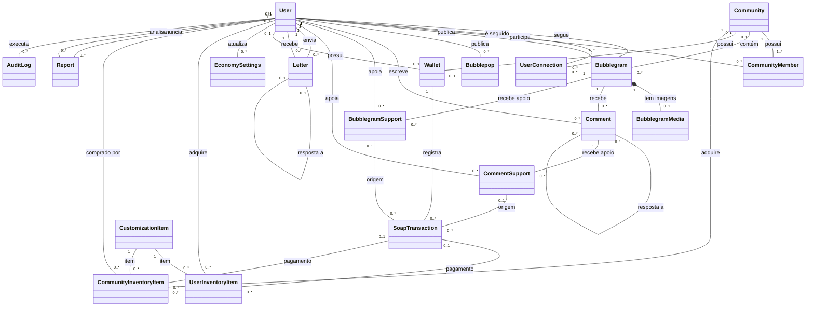
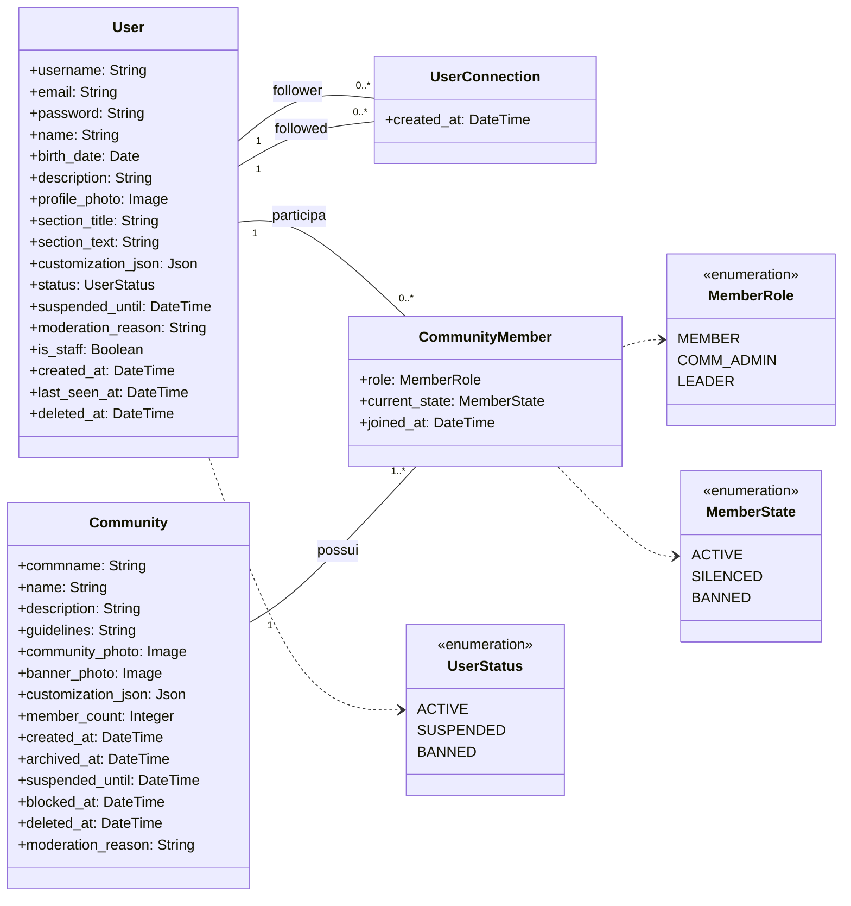
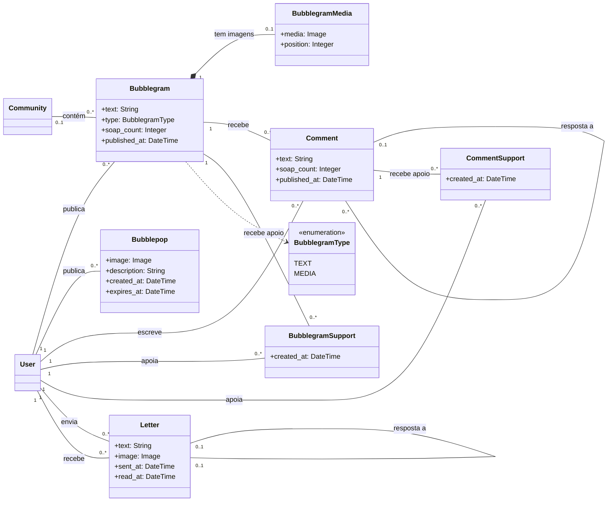
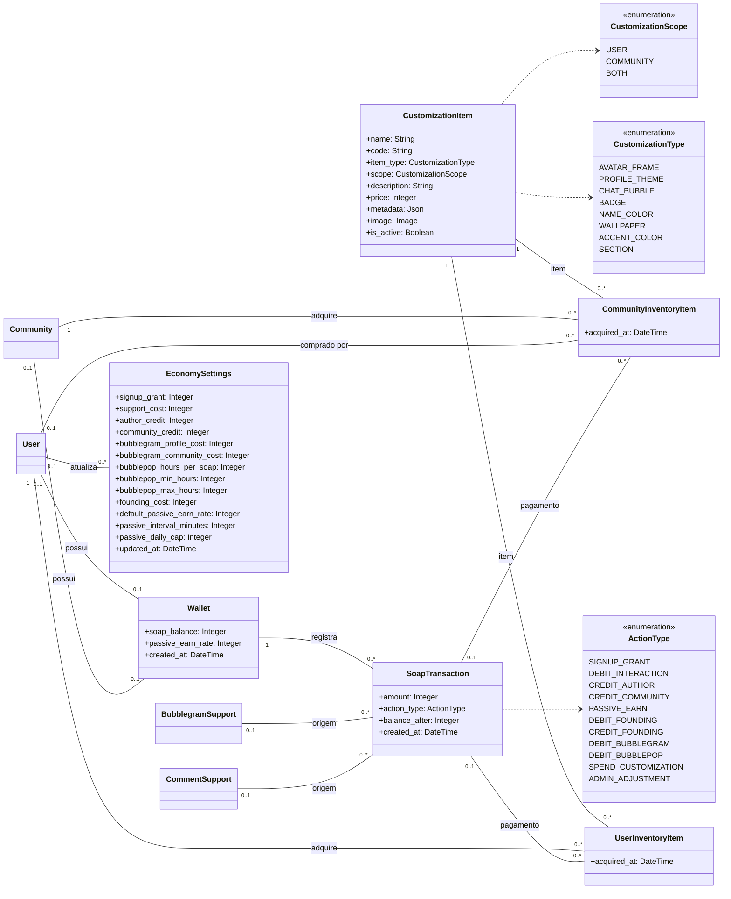
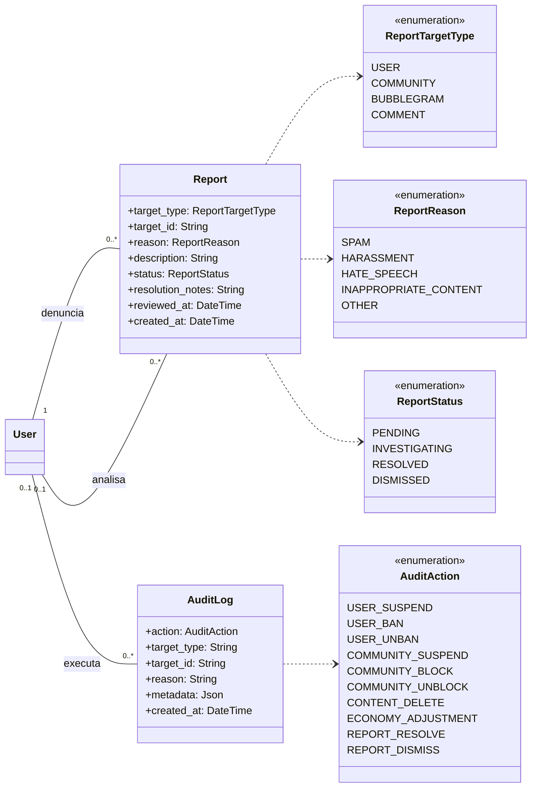

# 7 Diagrama de Classes

Os diagramas abaixo foram gerados a partir dos models do sistema (Django). Para manter a leitura simples, há um diagrama geral, só com as classes e suas relações, e quatro diagramas por domínio, com os atributos principais. Foram omitidos campos técnicos (chaves de idempotência, ativação interna da conta, grupos e permissões do framework). Os nomes das classes e dos atributos seguem o código.

## 7.1 Diagrama geral

## 7.2 Contas e comunidades

## 7.3 Conteúdo e cartas

## 7.4 Economia e personalização

## 7.5 Moderação

A denúncia (`Report`) identifica o alvo pelo tipo e pelo identificador (`target_type` e `target_id`), sem chave estrangeira, porque o alvo pode ser um usuário, uma comunidade, uma publicação ou um comentário. O mesmo vale para o registro de auditoria.

## Legenda

| Notação | Significado |
|---|---|
| `A "1" -- "0..*" B` | Associação: um A se relaciona com nenhum ou vários B |
| `A "1" *-- "0..1" B` | Composição: B só existe junto de A (a imagem de uma publicação) |
| `A ..> E` | A usa a enumeração E em um de seus atributos |
| `0..1`, `1`, `1..*`, `0..*` | Multiplicidade: opcional, exatamente um, um ou mais, zero ou mais |
| `<<enumeration>>` | Lista fixa de valores permitidos |

Observações de leitura:
- Uma `Wallet` pertence a exatamente um dono: um usuário **ou** uma comunidade.
- Em `UserConnection`, `follower` é quem segue e `followed` é quem é seguido.
- Em `Comment` e em `Letter`, a associação "resposta a" aponta para o comentário ou a carta respondida. Cada carta tem no máximo uma resposta.
- Datas opcionais (por exemplo `suspended_until`, `blocked_at`, `deleted_at` e `archived_at`) ficam vazias enquanto o estado correspondente não ocorre.

| Classe | Nome no documento |
|---|---|
| User | Usuário |
| UserConnection | Conexão (seguidor) |
| Community / CommunityMember | Comunidade / Membro da comunidade |
| Bubblegram / BubblegramMedia | Publicação permanente / Imagem da publicação |
| Bubblepop | Publicação temporária |
| Comment | Comentário |
| BubblegramSupport / CommentSupport | Apoio em publicação / Apoio em comentário |
| Letter | Carta |
| Wallet / SoapTransaction | Carteira / Movimentação de soap |
| EconomySettings | Configuração da economia |
| CustomizationItem | Item de customização |
| UserInventoryItem / CommunityInventoryItem | Item do usuário / Item da comunidade |
| Report / AuditLog | Denúncia / Registro de auditoria |
