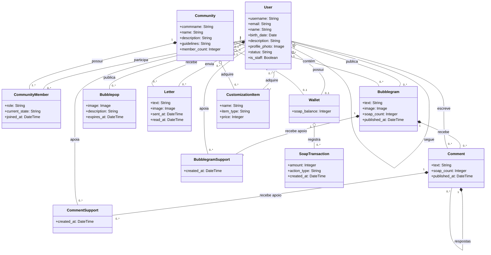

# 7 Diagrama de Classes (versão resumida)

Versão para apresentação, com as classes do funcionamento principal: usuários, comunidades, publicações, interações, cartas, carteira de soap e customização. Ficam de fora a moderação (denúncias e auditoria), a configuração da economia, as enumerações e as classes de apoio (conexão de seguidores, imagens da publicação e inventários), representadas por associações diretas. O diagrama completo está em `05_diagrama_de_classes.md`.

Valores dos atributos de texto:
- `User.status`: ACTIVE, SUSPENDED ou BANNED.
- `CommunityMember.role`: MEMBER, COMM_ADMIN ou LEADER. `current_state`: ACTIVE, SILENCED ou BANNED.
- `CustomizationItem.item_type`: moldura, tema, selo, cor do nome, papel de parede, cor de destaque, bolha de comentários e seção do perfil.

Tipos de relação usados:
- **Composição** (`*--`): a parte não existe sem o todo e é apagada junto com ele (membros da comunidade, comentários e apoios de uma publicação, respostas de um comentário, bubblepops do usuário).
- **Agregação** (`o--`): o todo reúne partes que continuam existindo sem ele (as publicações de um usuário ou comunidade, a carteira de seu dono, as movimentações de uma carteira, os itens que um usuário ou comunidade adquire).
- **Associação** (`--`): relação simples entre objetos independentes.
- **Generalização** (herança): o modelo de domínio não usa herança entre suas classes. Os papéis de comunidade (membro, administrador, líder) são valores de `CommunityMember.role`, e não subclasses. A única herança real está na classe `User`, mostrada no diagrama completo.

Observações: uma `Wallet` pertence a um usuário **ou** a uma comunidade. Uma `Bubblegram` com comunidade é uma publicação de comunidade; sem comunidade, é do perfil pessoal. O `Bubblepop` é a publicação temporária.
