# Diagrama de Classes completo (referência)

Diagrama com todas as classes do modelo de dados implementado, seus atributos, as enumerações e as relações com multiplicidade. É a referência de como o sistema foi implementado de fato, para consulta. A versão resumida, para apresentação, está em `07_diagrama_de_classes_enxuto.md`.

Do framework de autenticação do Django aparecem apenas as duas classes-base que o `User` realmente herda (`AbstractBaseUser` e `PermissionsMixin`); ficam de fora os grupos e as permissões. Os nomes seguem o código. As chaves estrangeiras aparecem como relações, não como atributos.

```mermaid
classDiagram
    direction TB

    class User {
        +username: String
        +email: String
        +name: String
        +birth_date: Date
        +description: String
        +profile_photo: Image
        +customization_json: Json
        +section_title: String
        +section_text: String
        +status: UserStatus
        +suspended_until: DateTime
        +moderation_reason: String
        +is_staff: Boolean
        +is_active: Boolean
        +created_at: DateTime
        +last_seen_at: DateTime
        +deleted_at: DateTime
    }

    class AbstractBaseUser {
        <<framework>>
        +password: String
        +last_login: DateTime
    }

    class PermissionsMixin {
        <<framework>>
        +is_superuser: Boolean
    }

    class UserConnection {
        +created_at: DateTime
    }

    class Community {
        +commname: String
        +name: String
        +description: String
        +guidelines: String
        +community_photo: Image
        +banner_photo: Image
        +customization_json: Json
        +member_count: Integer
        +created_at: DateTime
        +archived_at: DateTime
        +suspended_until: DateTime
        +blocked_at: DateTime
        +deleted_at: DateTime
        +moderation_reason: String
    }

    class CommunityMember {
        +role: MemberRole
        +current_state: MemberState
        +joined_at: DateTime
    }

    class Bubblegram {
        +text: String
        +type: BubblegramType
        +soap_count: Integer
        +published_at: DateTime
    }

    class BubblegramMedia {
        +media: Image
        +position: Integer
    }

    class Bubblepop {
        +image: Image
        +description: String
        +created_at: DateTime
        +expires_at: DateTime
    }

    class Comment {
        +text: String
        +soap_count: Integer
        +published_at: DateTime
    }

    class BubblegramSupport {
        +created_at: DateTime
    }

    class CommentSupport {
        +created_at: DateTime
    }

    class Letter {
        +text: String
        +image: Image
        +sent_at: DateTime
        +read_at: DateTime
    }

    class Wallet {
        +soap_balance: Integer
        +passive_earn_rate: Integer
        +created_at: DateTime
    }

    class SoapTransaction {
        +amount: Integer
        +action_type: ActionType
        +balance_after: Integer
        +idempotency_key: String
        +created_at: DateTime
    }

    class EconomySettings {
        +signup_grant: Integer
        +support_cost: Integer
        +author_credit: Integer
        +community_credit: Integer
        +bubblegram_profile_cost: Integer
        +bubblegram_community_cost: Integer
        +bubblepop_hours_per_soap: Integer
        +bubblepop_min_hours: Integer
        +bubblepop_max_hours: Integer
        +founding_cost: Integer
        +default_passive_earn_rate: Integer
        +passive_interval_minutes: Integer
        +passive_daily_cap: Integer
        +updated_at: DateTime
    }

    class CustomizationItem {
        +name: String
        +code: String
        +item_type: CustomizationType
        +scope: CustomizationScope
        +description: String
        +price: Integer
        +metadata: Json
        +image: Image
        +is_active: Boolean
        +created_at: DateTime
    }

    class UserInventoryItem {
        +acquired_at: DateTime
    }

    class CommunityInventoryItem {
        +acquired_at: DateTime
    }

    class Report {
        +target_type: ReportTargetType
        +target_id: String
        +reason: ReportReason
        +description: String
        +status: ReportStatus
        +resolution_notes: String
        +reviewed_at: DateTime
        +created_at: DateTime
    }

    class AuditLog {
        +action: AuditAction
        +target_type: String
        +target_id: String
        +reason: String
        +metadata: Json
        +created_at: DateTime
    }

    class UserStatus {
        <<enumeration>>
        ACTIVE
        SUSPENDED
        BANNED
    }

    class MemberRole {
        <<enumeration>>
        MEMBER
        COMM_ADMIN
        LEADER
    }

    class MemberState {
        <<enumeration>>
        ACTIVE
        SILENCED
        BANNED
    }

    class BubblegramType {
        <<enumeration>>
        TEXT
        MEDIA
    }

    class ActionType {
        <<enumeration>>
        SIGNUP_GRANT
        DEBIT_INTERACTION
        CREDIT_AUTHOR
        CREDIT_COMMUNITY
        PASSIVE_EARN
        DEBIT_FOUNDING
        CREDIT_FOUNDING
        DEBIT_BUBBLEGRAM
        DEBIT_BUBBLEPOP
        SPEND_CUSTOMIZATION
        ADMIN_ADJUSTMENT
    }

    class CustomizationType {
        <<enumeration>>
        AVATAR_FRAME
        PROFILE_THEME
        CHAT_BUBBLE
        BADGE
        NAME_COLOR
        WALLPAPER
        ACCENT_COLOR
        SECTION
    }

    class CustomizationScope {
        <<enumeration>>
        USER
        COMMUNITY
        BOTH
    }

    class ReportTargetType {
        <<enumeration>>
        USER
        COMMUNITY
        BUBBLEGRAM
        COMMENT
    }

    class ReportReason {
        <<enumeration>>
        SPAM
        HARASSMENT
        HATE_SPEECH
        INAPPROPRIATE_CONTENT
        OTHER
    }

    class ReportStatus {
        <<enumeration>>
        PENDING
        INVESTIGATING
        RESOLVED
        DISMISSED
    }

    class AuditAction {
        <<enumeration>>
        USER_SUSPEND
        USER_BAN
        USER_UNBAN
        COMMUNITY_SUSPEND
        COMMUNITY_BLOCK
        COMMUNITY_UNBLOCK
        CONTENT_DELETE
        ECONOMY_ADJUSTMENT
        REPORT_RESOLVE
        REPORT_DISMISS
    }

    AbstractBaseUser <|-- User
    PermissionsMixin <|-- User

    User "1" -- "0..*" UserConnection : follower
    User "1" -- "0..*" UserConnection : followed
    User "1" -- "0..*" CommunityMember : participa
    Community "1" *-- "1..*" CommunityMember : possui

    User "1" o-- "0..*" Bubblegram : publica
    Community "0..1" o-- "0..*" Bubblegram : contém
    Bubblegram "1" *-- "0..4" BubblegramMedia : tem imagens
    User "1" *-- "0..*" Bubblepop : publica
    Bubblegram "1" *-- "0..*" Comment : recebe
    User "1" -- "0..*" Comment : escreve
    Comment "1" *-- "0..*" Comment : respostas

    Bubblegram "1" *-- "0..*" BubblegramSupport : recebe apoio
    User "1" -- "0..*" BubblegramSupport : apoia
    Comment "1" *-- "0..*" CommentSupport : recebe apoio
    User "1" -- "0..*" CommentSupport : apoia

    User "1" -- "0..*" Letter : envia
    User "1" -- "0..*" Letter : recebe
    Letter "0..*" --> "0..1" Letter : responde a

    User "0..1" o-- "0..1" Wallet : possui
    Community "0..1" o-- "0..1" Wallet : possui
    Wallet "1" o-- "0..*" SoapTransaction : registra
    SoapTransaction "0..*" --> "0..1" BubblegramSupport : origem
    SoapTransaction "0..*" --> "0..1" CommentSupport : origem
    EconomySettings "0..*" --> "0..1" User : atualizada por

    User "1" *-- "0..*" UserInventoryItem : inventário
    UserInventoryItem "0..*" --> "1" CustomizationItem : item
    UserInventoryItem "0..*" --> "0..1" SoapTransaction : pagamento
    Community "1" *-- "0..*" CommunityInventoryItem : inventário
    CommunityInventoryItem "0..*" --> "1" CustomizationItem : item
    CommunityInventoryItem "0..*" --> "0..1" SoapTransaction : pagamento
    CommunityInventoryItem "0..*" --> "0..1" User : comprado por

    Report "0..*" --> "1" User : denunciante
    Report "0..*" --> "0..1" User : analisada por
    AuditLog "0..*" --> "0..1" User : executado por

    User ..> UserStatus
    CommunityMember ..> MemberRole
    CommunityMember ..> MemberState
    Bubblegram ..> BubblegramType
    SoapTransaction ..> ActionType
    CustomizationItem ..> CustomizationType
    CustomizationItem ..> CustomizationScope
    Report ..> ReportTargetType
    Report ..> ReportReason
    Report ..> ReportStatus
    AuditLog ..> AuditAction
```

## Regras do modelo que o diagrama não mostra

- Cada comunidade tem no máximo um líder (`CommunityMember.role = LEADER`).
- Uma `Wallet` pertence a exatamente um dono: um usuário **ou** uma comunidade.
- As movimentações de soap (`SoapTransaction`) só podem ser inseridas, nunca alteradas nem apagadas, e cada uma tem no máximo uma origem (apoio em publicação ou apoio em comentário).
- Cada usuário apoia uma publicação ou um comentário uma única vez. Um usuário não segue a si mesmo e só há uma conexão por par de usuários.
- Cada carta tem no máximo uma resposta, e uma resposta pertence ao mesmo par de usuários da carta original.
- A resposta de um comentário pertence à mesma publicação do comentário original.
- Um item não é adquirido duas vezes pelo mesmo usuário nem pela mesma comunidade.
- A denúncia (`Report`) e o registro de auditoria (`AuditLog`) identificam o alvo por tipo e identificador (`target_type` e `target_id`), sem chave estrangeira.
- A configuração da economia (`EconomySettings`) tem um único registro.
- O modelo aceita até 4 imagens por publicação (`BubblegramMedia`); a interface envia uma.

## Legenda

| Notação | Significado | Exemplo no modelo |
|---|---|---|
| `A "1" -- "0..*" B` | Associação simples | usuário escreve comentários |
| `A "0..*" --> "1" B` | Associação direcionada (A conhece B) | denúncia aponta o usuário denunciante |
| `A "1" o-- "0..*" B` | Agregação: B existe independentemente de A | usuário e suas publicações; carteira e suas movimentações |
| `A "1" *-- "0..*" B` | Composição: B depende de A e é apagado com ele | publicação e seus comentários, apoios e imagens |
| `A <\|-- B` | Generalização (herança): B é um tipo de A | `User` herda de `AbstractBaseUser` e `PermissionsMixin` |
| `A ..> E` | A usa a enumeração E em um atributo | `User` usa `UserStatus` |
| `<<enumeration>>`, `<<framework>>` | Lista fixa de valores; classe do framework Django | |

Como as relações foram escolhidas: **composição** onde o banco apaga a parte junto com o todo (exclusão em cascata); **agregação** onde a parte é protegida ou sobrevive ao todo (a carteira de uma conta e o histórico de soap são protegidos contra exclusão, e o conteúdo do usuário é anonimizado, não apagado, quando a conta é excluída); **associação direcionada** onde a referência é opcional e anulada se o outro objeto sumir (origem de uma movimentação, autor de uma auditoria). A **generalização** só aparece na classe `User`: o modelo de domínio não tem outras heranças.
